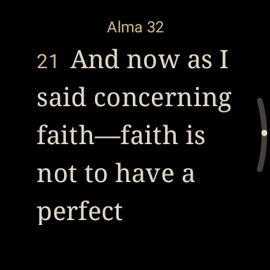
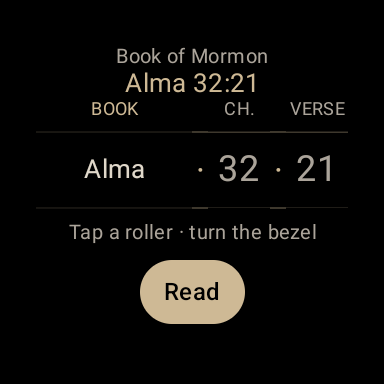
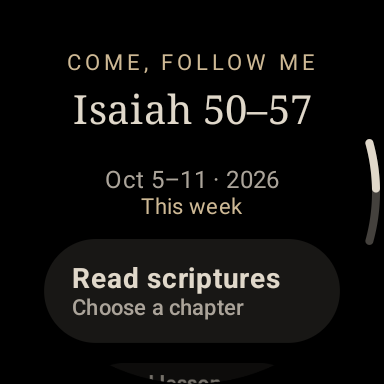
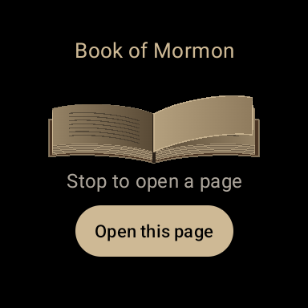
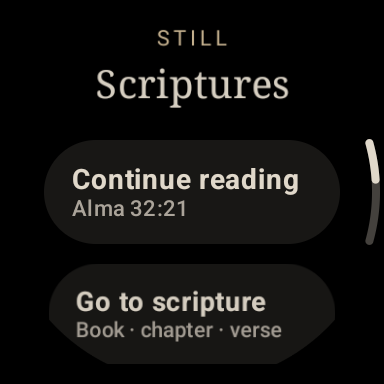

<p align="center">
  
</p>

<h1 align="center">Still Scriptures</h1>

<p align="center">
  <strong>A quiet way to end the day.</strong><br />
  Scripture reading on your wrist, made for a verse worth lingering over.
</p>

<p align="center">
  
  
  
</p>

<p align="center">
  <a href="https://github.com/keylimesoda/still-scriptures/releases/tag/v0.6.1"><strong>Download the watch app</strong></a>
  &nbsp;·&nbsp; <a href="#take-a-look">See the app</a>
  &nbsp;·&nbsp; <a href="#install">Installation guide</a>
</p>

---

Open your watch. Choose a passage. Turn the bezel and read.

**Still Scriptures** is a small, standalone Wear OS app built around bedtime
reading on a Galaxy Watch 6 Classic: a black screen, warm serif text, and the
whole chapter when you want to keep going. Your phone can stay on the nightstand.

## Take a look

<table>
  <tr>
    <td align="center" width="33%"></td>
    <td align="center" width="33%"></td>
    <td align="center" width="33%"></td>
  </tr>
  <tr>
    <td align="center"><strong>Settle into a chapter</strong><br /><sub>Warm type. Continuous scrolling.</sub></td>
    <td align="center"><strong>Go straight to a verse</strong><br /><sub>Three rollers. One screen.</sub></td>
    <td align="center"><strong>Keep up with the week</strong><br /><sub>Read the scriptures or the lesson.</sub></td>
  </tr>
</table>

<table>
  <tr>
    <td align="center" width="50%"></td>
    <td align="center" width="50%"></td>
  </tr>
  <tr>
    <td align="center"><strong>Let the pages find a passage</strong><br /><sub>Turn the bezel. Stop. See where you land.</sub></td>
    <td align="center"><strong>Pick up where you left off</strong><br /><sub>Your last reading position is one tap away.</sub></td>
  </tr>
</table>

<sub>Actual app captures from the optimized 0.6.1 build in a round Wear OS emulator. Screen size and text wrapping vary by watch.</sub>

## A few ways to begin

- True black background, warm serif text, adjustable 16–26 sp type.
- Continuous chapters, bezel/touch scrolling, exact last reading position,
  next chapter and optional screen-awake mode.
- Pick a scripture volume, then choose **Book · Chapter · Verse** on three
  timer-style rollers. Tap a roller to select it; turn the bezel; tap Read.
- **Come, Follow Me**: current calendar week, other weeks, assigned chapters,
  and a native lesson reader. 2026 and 2027 calendars are bundled.
- **Scripture of the day**: locally curated from the week's assigned readings,
  deterministic by calendar date, without a server. Not an official daily service.
- **Flip open**: choose a volume, turn the bezel through an animated open book,
  stop, and read the revealed verse in its chapter.
- **Saved verses**: tap a verse to save it. Hearts are local to the watch.
- **Share / open on phone**: scan a verse QR link and use Gospel Library or the
  browser to save or share it. This does not synchronize watch annotations.

## Chapter overviews and footnotes

Tap **Chapter overview** at the chapter title to expand the official summary
inline. It starts collapsed. Tap any verse, then **Footnotes**, for readable
notes and large cross-reference buttons. Turn the bezel to scroll. Numbered
references in the bundled scriptures open locally; Back returns through the
notes to the original chapter and its position. Topical Guide, Bible Dictionary,
JST and other unbundled study pages can be opened on a phone using a QR link.
Reference ranges open at their first verse; the full range remains in the note.
Letters next to verse numbers indicate notes in a downloaded chapter.

The first explicit overview or footnotes request for a chapter needs internet.
It downloads both together and retains them in private watch storage. Once
saved, that chapter's study helps work offline. A failed download offers retry
and leaves the bundled verse text available. There is no bulk background download.
Uninstalling or clearing app storage loses downloads and local saved verses.

## What works offline?

| Content | Available without internet? |
| --- | --- |
| Bundled scripture text, chapter navigation and reading | **Yes, from installation.** |
| Random opening and local saved verses | **Yes.** |
| 2026/2027 lesson calendars and local daily selections | **Yes, from installation.** |
| Official chapter overviews and footnotes | **After the first download for that chapter.** |
| Official lesson text | **After opening it online.** The last eight visited lessons are retained. |
| Calendar updates and first-time study downloads | Internet required. |


The APK includes **41,995 verses, 87 books, 1,582 chapters** from the five volumes
of [Ben Crowder's scripture dataset](https://github.com/bcbooks/scriptures-json),
marked public domain by its publisher. `CONTENT-SOURCE.json` pins the source
commit and checksums. Modern summaries and footnotes are excluded from those
assets; they are private, on-demand downloads from the official chapter pages.

Official Declarations 1 and 2, introductions, facsimiles, front matter and
standalone JST study aids are not bundled. This is not yet a complete offline
study edition of all standard works.

Lesson dates, assignments and source URLs are recorded in `LESSON-SOURCE.json`.
Official lesson prose is downloaded on opening and cached privately for the last
eight visited lessons. Images, videos and interactive activities are not shown.
Opening Come, Follow Me attempts calendar refresh at most weekly on a validated,
unmetered connection. Manual refresh can use any connection. Future-year URLs
assume the current four-year cycle; future data and daily selections need work.

Downloaded official material remains subject to the Church's
[terms of use](https://www.churchofjesuschrist.org/learn/legal/terms-of-use/go?lang=eng).
No downloaded chapter/lesson prose, Church credentials, personal caches or
signing keys are included in this repository.

Gospel Library's [deep links](https://www.churchofjesuschrist.org/learn/mobile-applications/deep-linking-in-gospel-library?lang=eng)
support manual phone handoff. No documented public third-party annotation-write
API was found. Use Gospel Library while signed in to save a bookmark/highlight
for its account sync. A portable backup of watch saves remains future work.

## Install

Download the optimized **release APK** from [the latest preview](https://github.com/keylimesoda/still-scriptures/releases/tag/v0.6.1).
Enable Developer options and Wireless debugging on the watch; keep it and your
computer on the same Wi-Fi. Use Android platform tools:

```powershell
adb pair WATCH_PAIRING_IP:PAIRING_PORT
# Enter the pairing code shown on the watch.
adb connect WATCH_IP:CONNECTION_PORT
adb -s WATCH_IP:CONNECTION_PORT install -r Still-Scriptures-0.6.1-release.apk
```

This preview has debugging disabled, R8 optimization and resource shrinking.
It retains the existing personal development certificate so installed previews
can update without losing data. It is not a Play Store release. Keep the same
signing key for future updates; another key requires reinstalling and loses data.
Your locally built copy uses your own development key, which differs from the
published preview. Signing keys are not committed.

## Build it yourself

Requires JDK 17 or 21 and Android SDK platform 35. Set `sdk.dir` in a local
`local.properties` or configure `ANDROID_HOME`.

```powershell
./gradlew.bat assembleRelease
# macOS/Linux:
# sh ./gradlew assembleRelease
```

Output: `app/build/outputs/apk/release/app-release.apk`.
<details>
<summary><strong>Toolchain, asset imports and development status</strong></summary>

Pinned toolchain: AGP 8.10.1, Gradle 8.11.1, Kotlin 2.2.21, Compose UI 1.8.2,
Wear Compose 1.5.0, Jsoup 1.18.3, ZXing Core 3.5.3. Release JSON models are
explicitly decoded and do not require reflection keep rules.

Assets are already checked in. `python tools/import_scriptures.py` reproduces
the pinned verse import. The optional calendar importer uses `beautifulsoup4`
and `tools/daily_selections.json`. Temporary downloads go to ignored `work/`.

Version 0.6 compiles as an optimized release. No new automated tests have been
run; older 0.1 tests do not validate this version. Existing picker UI tests
reflect earlier navigation and need updating when verification is requested.

</details>

## What's next?

Theme search, lasting save backups, the remaining scripture content, and Store readiness are next on the list.

See [PROJECT_PLAN.md](PROJECT_PLAN.md) for priorities and remaining work.
This repository does not yet grant a general source-code license; the bundled
scripture dataset and third-party libraries retain their separate terms.


---

<sub>An unofficial personal project, not affiliated with or endorsed by The Church of Jesus Christ of Latter-day Saints. See [THIRD_PARTY_NOTICES.md](THIRD_PARTY_NOTICES.md) for dataset and dependency attribution.</sub>
